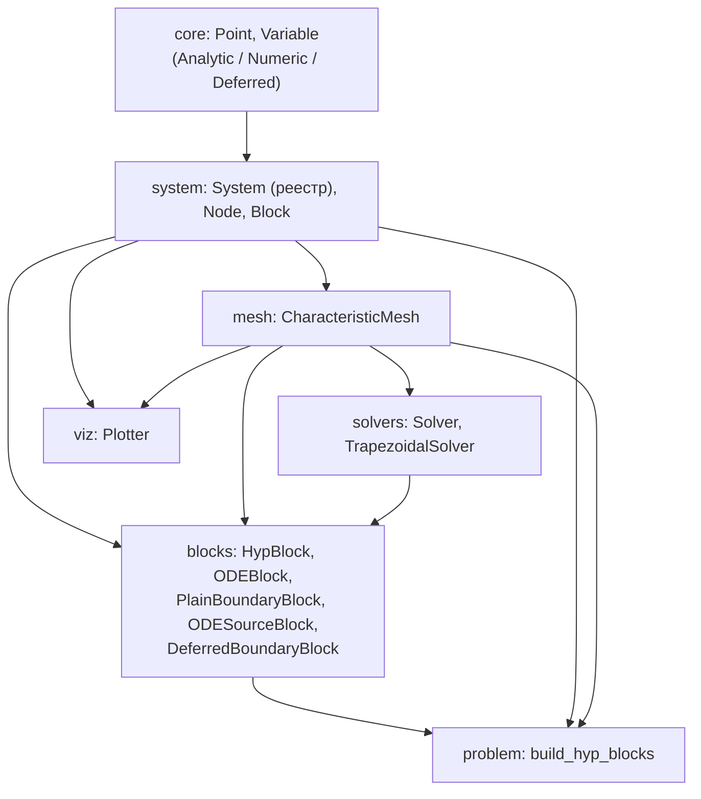
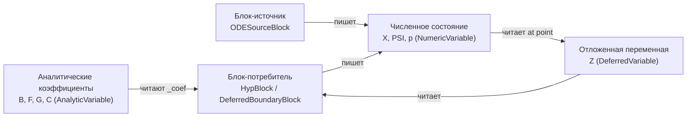

# Архитектура `cascadoc_new` — обзор

Страница отвечает на три вопроса: **из чего состоит** библиотека,
**как через неё течёт решение** и **где проходят границы текущих
возможностей**. Детали — на отдельных страницах (ссылки в конце).

---

## 1. Слои архитектуры

Код разбит на подпакеты; зависимости идут строго от `core` к `viz`
(без циклов), а «склейка» между крупными узлами идёт не объектами-связками,
а **общим хранилищем численных переменных**.

Публичный API «плоский»: пользователь почти всегда видит
`Point`, `System`, `CharacteristicMesh`, `build_hyp_blocks`, `Plotter`
(полный список — в `cascadoc_new/__init__.py`).

---

## 2. Три сущности, на которых держится всё

1. **`Point`** — произвольный кортеж координат, единый аргумент функций.
   Доступ к координатам — **только по индексу** (`point[0]`, `point[1]`).
   Имён `s`/`t` у точки нет (см. [`core`](architecture/core.md)).
2. **`Variable`** — именованная величина, определённая на точках.
   Три вида: **аналитическая** (считается по формуле), **численная**
   (хранит значения), **отложенная** (читается из другой переменной
   во время решения).
3. **`Block`** — единица композиции системы, решающая «свою» часть узлов
   послойно по времени `t`.

Связующее звено — **`NumericVariable`**: узел `Point` один и тот же для всех
блоков, поэтому значение, записанное одним блоком, сразу видно другому.
Отдельный объект `Interface` не нужен.

---

## 3. Сквозной поток данных

- **Аналитические** переменные (`B, F, G`, начальные `x0/y0`, терминальные
  `phi_*`) только **читаются** блоками и решателями через `_coef(system, name, point)`.
- **Численные** `X` (состояние), `PSI` (сопряжённое состояние), `p`
  (одномерная сопряжённая переменная — граничный прокси управления) —
  **читаются и пишутся** блоками через узлы `Node`.
- **Отложенная** `DeferredVariable` — тонкая ленивая ссылка на численную
  переменную-источник; заполняется блоком-производителем (например,
  `ODESourceBlock`) и читается блоком-потребителем
  (`DeferredBoundaryBlock`).

### Кто что пишет и читает (гиперболическая задача)

| Переменная | Вид | Пишет | Читает |
|------------|-----|-------|--------|
| `C1, C2, S0, S1, T0, T1` | analytic | пользователь (`build_*`) | `CharacteristicMesh`, `TrapezoidalSolver` |
| `B11, B12, B21, B22` | analytic | пользователь | `HypBlock` (внутри схемы), шаги границы |
| `F1, F2` | analytic | пользователь | `HypBlock`, шаги границы |
| `G11, G12, G21, G22` | analytic | пользователь | `ODEBlock`, `boundary_ode_step` |
| `x0, y0` | analytic | пользователь | начальный слой `HypBlock` |
| `phi_dx, phi_dy` | callable | пользователь (`var_callable`) | сопряжённый ход `TrapezoidalSolver` |
| `X` (dim=2) | numeric | все блоки (по своим узлам) | соседние блоки того же слоя |
| `PSI` (dim=2), `p` (dim=1) | numeric | сопряжённый ход решателя | сопряжённый ход |
| `Z` / source | deferred ← numeric | `ODESourceBlock` (в source) | `DeferredBoundaryBlock` |

---

## 4. Порядок решения

`System.solve()` идёт **послойно по возрастанию `t`**. Слои собираются
из всех блоков; на каждом слое блоки выполняются в порядке топологической
сортировки по явным зависимостям `Block.depends_on`. Блок без своего слоя
пропускается; после всех слоёв вызывается `Block.finalize` (для сборки
выходной границы `t = T1`).

Детали сортировки и послойного прохода — на странице
[`system`](architecture/system.md#solve).

---

## 5. Механизм отложенных значений = направленный граф (DAG)

`DeferredVariable` реализует поток **«источник → потребитель»**:

- блок-источник пишет значение в `NumericVariable`;
- блок-потребитель объявляет зависимость `depends_on=['<имя источника>']`
  (или через `source_block` в `DeferredBoundaryBlock`);
- `DeferredVariable.at(point)` в момент чтения достаёт значение из источника.

Это **ориентированный ациклический граф** зависимостей. Ожидается, что на
каждом слое источник посчитан раньше потребителя.

---

## 6. Известные ограничения {#known-limitations}

> Эти пункты — не пожелания, а **фактическое** поведение текущего кода.
> Подробный разбор и рекомендации: [`REVISION_ARCH.md`](../REVISION_ARCH.md).

### 6.1. Циклические зависимости не поддерживаются

- `System._sort_blocks` использует алгоритм Кана. Блоки, попавшие в цикл,
  **никогда** не получают `in_degree == 0`, поэтому не попадают в
  топологический результат, а добавляются в конец **в порядке `add_block`**
  (`return result + remaining`). Ошибка при этом **не бросается** — порядок
  получается молча неверным.
- `System.solve()` — **один проход** на слой, без итераций до сходимости и без
  совместного решения связанной группы. Значение, нужное «до» его вычисления
  (петля), получить неоткуда.
- `DeferredVariable.at` при отсутствии значения **бросает `RuntimeError`**
  с подсказкой «проверьте зависимости блоков», а не возвращает текущую
  оценку. Это делает итерацию по петле невозможной.
- Блок-источник `ODESourceBlock` решает **автономное** ОДУ `dz/dt = f(z, t)`:
  его правая часть не видит состояние ДУЧП на том же слое, а начальное
  значение `z(T0)` — константа.
- `DeferredBoundaryBlock` жёстко фиксирует роль отложенной компоненты:
  `side='left'` → компонента 1 (`y`), `side='right'` → компонента 0 (`x`).
  Произвольную компоненту через публичный API задать нельзя.

Итог: архитектура рассчитана на **DAG**; цикл — молчаливо неверный порядок.
Это задокументировано как известное ограничение и предмет roadmap
(см. [`REVISION_ARCH.md`](../REVISION_ARCH.md), разделы 3 и 4).

### 6.2. Прочие расхождения, которые надо держать в голове

- У `Point` и `Node` **нет** свойств `s`/`t` — только индексный доступ
  (`point[0]`, `point[1]`). Старые тесты (`tests/test_deferred_boundary.py`),
  использующие `point.s`/`node.t`, **не запускаются**.
- `Block.provides` объявлен, но **не используется** сортировкой;
  зависимости — ручные строки имён блоков (`depends_on`).
- `DeferredVariable` делает один хоп `deferred → source`; цепочек и
  разрешения по нескольким источникам нет.
- `src/cascadoc_new/README.md` местами **устарел** (например, сигнатура
  `DeferredVariable`, описания `.s/.t`); эта документация ориентируется на
  фактический код.

---

## 7. Ссылки на детальные разделы

- [`core`](architecture/core.md) — `Point`, `Variable` и его виды, утилиты.
- [`system`](architecture/system.md) — `Node`, `System`, `Block`, `solve()`.
- [`mesh-and-solvers`](architecture/mesh-and-solvers.md) — сетка и схемы.
- [`blocks`](architecture/blocks.md) — конкретные блоки и шаги границы.
- [`problem-and-viz`](architecture/problem-and-viz.md) — сборка и `Plotter`.
- Путеводитель [`guide.md`](guide.md) — как собрать систему, блоки и связи.
- Пример [`../example/cascadoc_new_guide.ipynb`](../example/cascadoc_new_guide.ipynb) —
  рабочий запускаемый пример (гиперболическая система + вычисляемая переменная).
